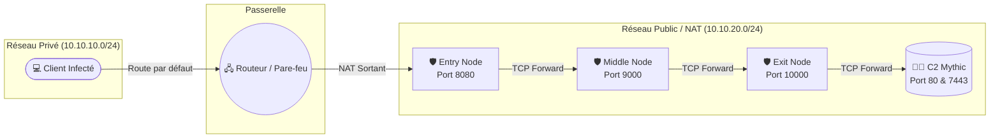

# Proxychain & C2 Infrastructure PoC


Ce projet est une **Preuve de Concept (PoC) d'Infrastructure as Code (IaC)** permettant de déployer de manière entièrement automatisée un environnement de type "Red Team". Il met en place un serveur Command & Control (C2) [Mythic](https://github.com/its-a-feature/Mythic), protégé par une chaîne de rebond (Proxychain) configurée sur mesure, ainsi qu'un réseau cible isolé contenant une victime simulée.

L'intégralité du déploiement (création des VM, réseau, et configuration logicielle) est gérée par **Terraform** et **Ansible** au-dessus de **KVM/Libvirt**.

> ⚠️ **Avertissement :** Ce projet est fourni à des fins strictement **éducatives et de recherche en cybersécurité**. Il ne doit en aucun cas être utilisé sur des infrastructures sans autorisation explicite.

---

## Topologie de l'Infrastructure

L'infrastructure se divise en deux réseaux virtuels distincts pour simuler une attaque depuis l'extérieur vers un réseau interne d'entreprise.



### Rôle des Machines

*   **`c2`** : Héberge le framework Mythic (Interface Web + Écouteur HTTP C2).
*   **`exit_node`**, **`middle_node`**, **`entry_node`** : Composent la chaîne de rebond. Chacun exécute un script Python natif agissant comme un *TCP Port Forwarder*, masquant ainsi l'origine véritable du C2 à la victime.
*   **`router`** : Fait le pont entre le réseau privé et public avec du NAT (Masquerade).
*   **`client`** : La victime. Elle n'a d'adresse IP que dans le sous-réseau privé et accède à internet (ou au C2) uniquement via le `router`.

---

## Prérequis

Avant de lancer le déploiement, assurez-vous de disposer d'un hôte Linux (Ubuntu/Debian recommandé) avec les éléments suivants :

1. **Hyperviseur KVM/Libvirt** fonctionnel.
   
```bash
   sudo apt update
   sudo apt install qemu-kvm libvirt-daemon-system libvirt-clients bridge-utils virtinst
```

2. **Terraform** (version >= 1.4)
3. **Ansible** (avec Python 3)
   
```bash
   sudo apt install ansible python3
```

4. **Clé SSH locale** (Ed25519) présente dans `~/.ssh/id_ed25519.pub`. Si elle n'existe pas, générez-la :
   
```bash
   ssh-keygen -t ed25519 -f ~/.ssh/id_ed25519 -N ""
```

---

##  Déploiement

Le processus a été pensé pour être **"One-Click"**. Terraform va préparer les machines, créer les réseaux virtuels, générer l'inventaire dynamiquement, et lancer automatiquement Ansible.

1. **Initialiser Terraform** :
   
```bash
   terraform init
```

2. **Vérifier le plan de déploiement** :
   
```bash
   terraform plan
```

3. **Déployer l'infrastructure** :
   
```bash
   terraform apply -auto-approve
```

*(Note : Le déploiement complet peut prendre entre 5 et 10 minutes, notamment à cause du téléchargement de l'image Ubuntu Cloud, de l'installation de Docker et de la compilation de Mythic-CLI via Ansible).*

---

## 🎮 Utilisation post-déploiement

Une fois `terraform apply` terminé, Terraform affichera un bloc d'**Outputs** détaillant toutes les adresses IP et les commandes SSH prêtes à l'emploi.

### 1. Accéder à l'interface du C2 (Mythic)
Mythic est exposé sur l'adresse IP NAT de la machine `c2`.
* **URL** : `https://<IP_DU_C2>:7443` (Acceptez l'avertissement de certificat auto-signé SSL)
* **Utilisateur** : `mythic`
* **Mot de passe** : `mythic`

*Note: Les agents `Poseidon`, `Apollo` et le profil `http` sont déjà pré-installés automatiquement !*

### 2. Tester la chaîne de Proxy (Proxychain)
Le script de proxychain (`proxy.py`) redirige de manière transparente les paquets TCP. Le port HTTP 80 du C2 est "remonté" à travers les nœuds jusqu'au port 8080 du nœud d'entrée.

Connectez-vous à la machine cliente (victime) en utilisant la commande SSH fournie dans l'output de Terraform (elle utilise le routeur comme *Jump Host* ou Bastion) :
```bash
# Exemple générique (voir vos outputs)
ssh -J ubuntu@<IP_ROUTER_NAT> ubuntu@<IP_CLIENT_PRIVEE>
```

Depuis le `client`, effectuez une requête HTTP vers le port d'entrée de la chaîne :
```bash
# Depuis la VM "client"
curl http://<IP_ENTRY_NODE>:8080
```
Si le retour affiche la page d'accueil par défaut de Mythic, **votre proxychain est fonctionnelle !** Tous vos payloads exécutés sur la machine cible pourront pointer vers `http://<IP_ENTRY_NODE>:8080` au lieu de pointer directement sur le C2.

---

##  Structure du Projet

```text
.
├── main.tf                 # Logique principale de déploiement Terraform (VM, Réseaux libvirt)
├── variables.tf            # Personnalisation (RAM, CPU, sous-réseaux, clé SSH)
├── ansible.cfg             # Configuration Ansible (pointe vers l'inventaire généré)
├── ansible/
│   ├── site.yml            # Playbook principal orchestrant les rôles
│   ├── tasks/
│   │   ├── c2_task.yml     # Installation de Docker, Mythic et des agents
│   │   └── proxy_task.yml  # Déploiement du script Python en service systemd
│   ├── files/
│   │   └── proxy.py        # Custom TCP Port Forwarder Python
│   └── templates/
│       ├── proxy.conf.j2   # Template du fichier de config du proxychain
│       └── proxy.service.j2# Template systemd
└── README.md
```

### Détails Techniques 
* **Bypass des limitations du provider Libvirt** : Au lieu d'utiliser le provider libvirt classique (souvent instable avec les configurations réseau complexes), `main.tf` utilise `local-exec` et la commande `virsh` native pour construire avec précision les réseaux NAT/Isolés et injecter proprement l'ISO cloud-init (via `genisoimage`).
* **Cloud-Init Dynamique** : L'adressage IP (statique pour le LAN, DHCP assigné via adresse MAC pour le WAN) est pré-calculé par Terraform puis poussé dans un fichier `network-config` v2 pour éviter la moindre erreur de résolution Netplan.

---

##  Nettoyage

Pour supprimer intégralement l'infrastructure, les machines virtuelles, les pools de stockage et les réseaux associés :

```bash
terraform destroy -auto-approve
```

---

##  Licence
Ce projet est développé comme une démonstration technique (PoC). Vous êtes libre de l'utiliser, le modifier et le redistribuer selon vos besoins.